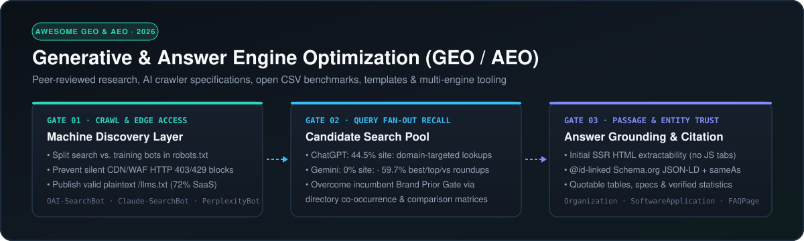

# Awesome GEO & AEO [](https://awesome.re) [](https://github.com/innflows/awesome-geo-aeo/actions/workflows/validate.yml) [](./LICENSE)

<p align="center">
  
</p>

<p align="center">
  <strong>English</strong> · <a href="./README_CN.md">简体中文</a> · <a href="./benchmarks/README.md">Open CSV Benchmarks</a> · <a href="./reference/ai-crawlers-matrix.md">AI Crawlers Matrix</a> · <a href="./templates/">Production Templates</a>
</p>

> A curated, engineering-first handbook and open benchmark hub for **Generative Engine Optimization (GEO)** and **Answer Engine Optimization (AEO)**—measuring and improving how brands, products, and technical documentation are discovered, retrieved, and cited across **ChatGPT Search, Google Gemini, Google AI Overviews, Google AI Mode, Perplexity, Claude, Copilot, Grok, DeepSeek, and Qwen**.

*Also indexed as: AI Search Optimization · LLM SEO · AI Visibility Optimization · Retrieval-Augmented Search SEO.*

---

## Contents

1. [SEO vs. AEO vs. GEO: Engineering Architecture](#1-seo-vs-aeo-vs-geo-engineering-architecture)
2. [Official AI Search Crawlers & Bot Specifications (2026)](#2-official-ai-search-crawlers--bot-specifications-2026)
3. [Open Empirical Benchmarks & CSV Datasets (`benchmarks/`)](#3-open-empirical-benchmarks--csv-datasets-benchmarks)
4. [Peer-Reviewed Research Papers (2023–2026)](#4-peer-reviewed-research-papers-20232026)
5. [Official Platform Documentation & Industry Studies](#5-official-platform-documentation--industry-studies)
6. [Tools & Platforms Ecosystem (Open-Source & Commercial)](#6-tools--platforms-ecosystem-open-source--commercial)
   - [Open-Source CLI Audits, Evals & MCP Servers](#61-open-source-cli-audits-evals--mcp-servers)
   - [Multi-Engine GEO & AEO Platforms (2026 Comparison Matrix)](#62-multi-engine-geo--aeo-platforms-2026-comparison-matrix)
7. [Copy-Paste Production Templates (`templates/`)](#7-copy-paste-production-templates-templates)
8. [10-Point Technical AI-Readiness Checklist](#8-10-point-technical-ai-readiness-checklist)
9. [Contributing & Citation](#9-contributing--citation)

---

## 1. SEO vs. AEO vs. GEO: Engineering Architecture

Search-grounded AI assistants do not rank ten blue links directly from a single inverted-index lookup. Instead, they execute a **three-gate retrieval-augmented generation (RAG) pipeline**:

| Dimension | Traditional SEO | Answer Engine Optimization (AEO) | Generative Engine Optimization (GEO) |
| :--- | :--- | :--- | :--- |
| **Primary Surfaces** | Google / Bing organic SERPs | Featured Snippets, PAA, Voice, Perplexity, Google AI Overviews | Multi-turn LLM synthesis: ChatGPT, Gemini, Google AI Mode, Claude, Grok, DeepSeek, Qwen |
| **Query Mechanics** | User's literal keyword string | Question-intent phrasing (`what is`, `how to`, `vs`) | **Multi-query fan-out** (`2–5+` rewritten background web searches per prompt, often injecting `site:` or incumbent brand priors) |
| **Unit of Competition** | Full URL / document PageRank | Concise Q&A block & `FAQPage` / `HowTo` markup | **Server-rendered passages, comparison tables, `@id` entity graphs & third-party directory co-occurrence** |
| **Core KPIs** | Rank position, impressions, CTR | Answer box ownership, direct citation link | **Unbranded category mention share, cited URL share, sentiment & cross-model trust consistency** |

---

## 2. Official AI Search Crawlers & Bot Specifications (2026)

Every major AI lab now separates **live search/citation crawlers** from **foundation-model training crawlers**. Blanket-blocking AI bots in `robots.txt` suppresses live citations even when your only goal is opting out of pre-training.

👉 **Full 18-bot specification & WAF allowlisting guide**: [`reference/ai-crawlers-matrix.md`](./reference/ai-crawlers-matrix.md)

| Vendor | Live Search & Citation Bots (**Keep `Allow`**) | Model Training Bots (*Optional Opt-Out*) | Official IP / Policy Reference |
| :--- | :--- | :--- | :--- |
| **OpenAI** | `OAI-SearchBot`, `ChatGPT-User` | `GPTBot` | [OpenAI Crawlers Overview](https://platform.openai.com/docs/bots) (`openai.com/searchbot.json`) |
| **Anthropic** | `Claude-SearchBot`, `Claude-User` | `ClaudeBot` | [Anthropic Web Crawlers](https://support.anthropic.com/en/articles/8896518-does-anthropic-crawl-data-from-the-web-and-how-can-site-owners-block-the-crawler) |
| **Google** | `Googlebot` | `Google-Extended` | [Google Common Crawlers](https://developers.google.com/search/docs/crawling-indexing/google-common-crawlers) |
| **Perplexity** | `PerplexityBot`, `Perplexity-User` | *(Separated from search index)* | [Perplexity Crawlers](https://docs.perplexity.ai/guides/bots) (`perplexity.ai/perplexitybot.json`) |
| **Microsoft** | `Bingbot` | — | [Bingbot Verification](https://www.bing.com/webmasters/help/verifying-bingbot-3905dc26) |
| **Apple** | `Applebot` | `Applebot-Extended` | [About Applebot](https://support.apple.com/en-us/119829) |

---

## 3. Open Empirical Benchmarks & CSV Datasets (`benchmarks/`)

This repository hosts machine-readable CSV datasets from empirical audits so researchers, technical SEOs, and writers can inspect and cite primary numbers directly (see [`benchmarks/README.md`](./benchmarks/README.md)):

### Dataset A — Native Query Fan-Out Mechanics (`36,000+` Web Searches Across `~12,000` Responses)

- **CSV Files**: [`benchmarks/fanout-query-mechanics-2026.csv`](./benchmarks/fanout-query-mechanics-2026.csv) · [`benchmarks/chatgpt-site-operator-targets-2026.csv`](./benchmarks/chatgpt-site-operator-targets-2026.csv)
- **Full Study**: [How ChatGPT and Gemini Actually Search the Web: Analyzing 36,000+ Native Fan-Out Queries](https://www.innflows.com/blog/seo/how-chatgpt-and-gemini-search-the-web-36k-query-study)

| Metric | ChatGPT (OpenAI Web Search) | Gemini (Google Search Grounding) | Practical Engineering Implication |
| :--- | :---: | :---: | :--- |
| **Sample Scale** | `~6,100` answers / `22,000+` queries | `~5,600` answers / `13,000+` queries | Provider-level search traces across unbranded & comparison prompts |
| **Mean Queries / Response** | **`3.68`** (median `3.0`, P90 `5`) | **`2.32`** (median `2.0`, P90 `3`) | Over `77%` of Gemini answers fire exactly 2 searches with no second-round lookup |
| **Mean Query Length** | `9.5` words (`70.5` chars) | `7.9` words (`51.1` chars) | ChatGPT appends longer attribute and freshness constraints |
| **`site:` Operator Usage** | **`44.5%`** (`62.8%` to official brand sites) | **`0.0%`** | ChatGPT verifies specs on first-party SSR pages; client-side hidden tabs fail verification |
| **`best` / `top` Modifiers** | `19.2%` | **`42.7%`** | Gemini leans heavily on multi-vendor roundup listicles |
| **`vs` / `comparison` Modifiers** | `4.6%` | **`17.0%`** | Structured `A vs. B` comparison matrices capture `3.7×` higher query share on Gemini |
| **Explicit Year (`2025`/`2026`)** | **`21.9%`** | `2.7%` | Explicit year stamps in titles/headings match `1 in 5` ChatGPT searches |

### Dataset B — State of B2B SaaS AI Search Readiness (`N = 100` Stratified Public Domains, Nov 2026)

- **CSV Files**: [`benchmarks/b2b-saas-ai-readiness-2026.csv`](./benchmarks/b2b-saas-ai-readiness-2026.csv) · [`benchmarks/b2b-saas-schema-coverage-2026.csv`](./benchmarks/b2b-saas-schema-coverage-2026.csv)
- **Full Study**: [State of B2B SaaS AI Search Readiness (Nov 2026): Auditing 100 Public Websites](https://www.innflows.com/blog/seo/state-of-b2b-saas-ai-search-readiness-100-website-study)

| B2B SaaS Cohort (`n = 20` each) | Non-JS HTTP 200 Reachable | Valid `/llms.txt` | Valid `/llms-full.txt` | JSON-LD (`% of Reachable`) | Mean Readiness Score (`/100`) |
| :--- | :---: | :---: | :---: | :---: | :---: |
| **DevTools & Cloud Infra** | `95%` (19/20) | **`90%`** (18/20) | **`45%`** (9/20) | **`100.0%`** (19/19) | **`94.5`** |
| **CRM, Marketing & Analytics** | `95%` (19/20) | **`85%`** (17/20) | `15%` (3/20) | `94.7%` (18/19) | **`93.3`** |
| **AI-Native & LLM Infra** | `100%` (20/20) | `70%` (14/20) | `10%` (2/20) | `65.0%` (13/20) | `89.5` |
| **Productivity & Design** | `100%` (20/20) | `65%` (13/20) | `15%` (3/20) | `70.0%` (14/20) | `89.0` |
| **Fintech, Security & Data** | `75%` (15/20) | `50%` (10/20) | `15%` (3/20) | `66.7%` (10/15) | `72.2` |
| **All Audited B2B SaaS (`N = 100`)** | **`93%` (93/100)** | **`72%` (72/100)** | **`20%` (20/100)** | **`79.6%` (74/93)** | **`87.7`** |

> **Key Failure Modes Observed**: `0%` (`0/95`) block AI search crawlers in `robots.txt`, yet **`7%` (`7/100`) silently block non-JS HTTP agents at the CDN/WAF edge** (`HTTP 403/429`), **`5%` serve SPA `text/html` soft-200 shells on `/llms-full.txt`**, and **`76.3%` of reachable SaaS homepages omit `SoftwareApplication` JSON-LD**.

---

## 4. Peer-Reviewed Research Papers (2023–2026)

### Foundational GEO & Retrieval Mechanics

- **[GEO: Generative Engine Optimization](https://arxiv.org/abs/2311.09735)** *(KDD 2024 · Aggarwal et al., Princeton, Georgia Tech, Allen AI & IIT Delhi)* — Introduces the formal GEO benchmark (`GEO-bench`, 10k queries) and demonstrates up to `40%` relative visibility gains from verifiable statistics, inline citations, and authoritative quotations, while showing traditional keyword stuffing underperforms. ([ACM DOI](https://dl.acm.org/doi/10.1145/3637528.3671900))
- **[C-SEO Bench: Does Conversational SEO Work?](https://openreview.net/forum?id=oTeixD3oZO)** *(NeurIPS 2025 Datasets & Benchmarks)* — Evaluates conversational SEO perturbations across multi-actor adoption rates, demonstrating why retrieval ranking position and factual density remain foundational when competitors optimize simultaneously.
- **[AutoGEO: What Generative Search Engines Like and How to Optimize Web Content Cooperatively](https://openreview.net/forum?id=K8EinVWtUB)** *(ICLR 2026 · CMU)* — Automatically induces engine-specific preference rules from generative search outputs to rewrite web documents without degrading factual fidelity.
- **[Think Before Writing: Feature-Level Multi-Objective Optimization for Generative Citation Visibility (FeatGEO)](https://aclanthology.org/2026.acl-long.929/)** *(ACL 2026)* — Optimizes interpretable document-level structural and linguistic features rather than black-box token edits, showing citation likelihood depends primarily on passage structure and information completeness.
- **[E-GEO: A Testbed for Generative Engine Optimization in E-Commerce](https://arxiv.org/abs/2511.20867)** *(arXiv 2025)* — Evaluates 15 content rewriting heuristics across `7,000+` product-discovery queries in e-commerce RAG pipelines.
- **[Beyond the Vacuum: Combinatorial Strategy Selection for Competitor-Aware GEO](https://arxiv.org/abs/2608.27631)** *(arXiv 2026)* — Models multi-vendor GEO as a non-zero-sum competitive game where optimal document strategies shift as category peers adopt structured optimization.
- **[Search-o1: Agentic Search-Enhanced Large Reasoning Models](https://arxiv.org/abs/2501.05366)** *(arXiv 2025)* — Details how reasoning LLMs iteratively trigger multi-step web searches during inference to resolve knowledge gaps.

### Knowledge Conflicts, Trust & Adversarial Robustness

- **[ConflictBank: A Benchmark for Evaluating the Influence of Knowledge Conflicts in LLMs](https://arxiv.org/abs/2408.12076)** *(NeurIPS 2024 · `7.4M` claim-evidence pairs)* — Examines how models arbitrate between parametric pre-training priors and retrieved external web evidence.
- **[GEO-Bench: Benchmarking Ranking Manipulation in Generative Engine Optimization](https://arxiv.org/abs/2605.29107)** *(arXiv 2026)* — Evaluates white-hat structural optimization vs. adversarial manipulation across effectiveness and stealth metrics.
- **[GASLITE: Adversarial SEO Attacks on Dense Retrieval](https://arxiv.org/abs/2412.20953)** *(arXiv 2024)* — Demonstrates dense-retriever poisoning risks and why production answer engines increasingly cross-check authoritative domain graphs.
- **[Strategic Text Sequences & Adversarial SEO for LLMs](https://arxiv.org/abs/2406.18382)** *(arXiv 2024)* — Studies prompt-injection and hidden-text manipulation risks, underscoring why durable brand GEO must rely on transparent white-hat structure rather than brittle adversarial tricks.

---

## 5. Official Platform Documentation & Industry Studies

### Official Standards & Search Central Guides

- **[Google Search Central — Succeeding in AI Search Experiences](https://developers.google.com/search/blog/2025/05/succeeding-in-ai-search)** — Google's official guidance for AI Overviews and AI Mode crawlability, structured data parity, and content originality.
- **[OpenAI — Overview of OpenAI Crawlers (`OAI-SearchBot`, `ChatGPT-User`, `GPTBot`)](https://platform.openai.com/docs/bots)** — Official `robots.txt` rules and verifiable IP ranges for ChatGPT Search citations.
- **[`llms.txt` Specification (`llmstxt.org`)](https://llmstxt.org/)** — Jeremy Howard's specification for serving concise, LLM-friendly Markdown site indexes at `/llms.txt` and `/llms-full.txt`.
- **[RFC 9309 — Robots Exclusion Protocol](https://www.rfc-editor.org/rfc/rfc9309.html)** — IETF standard governing longest-match precedence, wildcards, and `$` end-anchors in `robots.txt`.
- **[Schema.org Structured Data Vocabulary](https://schema.org/docs/schemas.html)** — Canonical specification for `Organization`, `SoftwareApplication`, `Product`, `Article`, `FAQPage`, and `@id` entity linking.

### Empirical Industry Benchmarks

- **[How ChatGPT and Gemini Actually Search the Web (`36,000+` Native Fan-Out Queries)](https://www.innflows.com/blog/seo/how-chatgpt-and-gemini-search-the-web-36k-query-study)** *(Innflows Research, Nov 2026)* — Provider-trace study of query budgets, `44.5%` vs. `0.0%` `site:` asymmetry, and the Brand Prior Gate.
- **[State of B2B SaaS AI Search Readiness (`100` Public Websites Audited)](https://www.innflows.com/blog/seo/state-of-b2b-saas-ai-search-readiness-100-website-study)** *(Innflows Research, Nov 2026)* — Stratified HTTP, `robots.txt`, `/llms.txt`, WAF, and JSON-LD audit across five SaaS verticals.
- **[2026 AEO / GEO Benchmarks Report](https://www.conductor.com/academy/aeo-geo-benchmarks-report/)** *(Conductor, 2026)* — Large-scale referral traffic and AI citation share analysis across `13,770` enterprise domains.
- **[How Vercel Adapts SEO for LLMs and AI Search](https://vercel.com/blog/how-were-adapting-seo-for-llms-and-ai-search)** *(Vercel Engineering)* — First-party engineering walkthrough on SSR payload clarity, docs structure, and bot telemetry.

---

## 6. Tools & Platforms Ecosystem (Open-Source & Commercial)

### 6.1 Open-Source CLI Audits, Evals & MCP Servers

- **[`innflows/website-ai-readiness-audit`](https://github.com/innflows/website-ai-readiness-audit)** *(MIT · Node.js & Python · Official MCP Registry `io.github.innflows/ai-readiness-audit`)* — Zero-dependency CLI (`npx @innflows/ai-readiness-audit <url>`) and stdio **Model Context Protocol (MCP) server** running a deterministic check across 14 AI crawlers in `robots.txt`, `/llms.txt` soft-404 detection, `/sitemap.xml`, SSR HTML visible character extractability, security headers, and `Schema.org` JSON-LD entity graphs.
- **[`AnswerDotAI/llms-txt`](https://github.com/AnswerDotAI/llms-txt)** *(Apache-2.0)* — Reference specification, parser, and context-generation utilities for `/llms.txt`.
- **[`danishashko/geo-aeo-tracker`](https://github.com/danishashko/geo-aeo-tracker)** *(Open Source)* — Self-hosted BYOK dashboard for running local prompt visibility checks across LLM APIs.
- **[`amplifying-ai/ai-product-bench`](https://github.com/amplifying-ai/ai-product-bench)** *(Open Source)* — Evaluation harness for testing product recommendation recall across language models.
- **[Google Rich Results Test](https://search.google.com/test/rich-results)** & **[Schema Markup Validator](https://validator.schema.org/)** — Free official validators for verifying JSON-LD syntax and Google rich-result eligibility.

### 6.2 Multi-Engine GEO & AEO Platforms (2026 Comparison Matrix)

*Note: Tier structures and tracked surfaces evolve frequently across SaaS vendors; pricing below reflects publicly documented self-serve or enterprise models verified in November 2026.*

| Platform | Core AI Surfaces Tracked | Cited URL Inspection | Technical Website AI Audit & Optimization Loop | Public Pricing Model (Verified Nov 2026) |
| :--- | :--- | :--- | :--- | :--- |
| **[Innflows](https://www.innflows.com)** | ChatGPT, Gemini, Google AI Overviews, Google AI Mode, Grok, DeepSeek, Qwen *(+ APAC edition)* | Yes — archived full response + prompt-level cited URLs & 5D FLOWS trust scores | **Yes** — 18-check Website AI-Readiness Audit + AI content studio + [Shopify app](https://apps.shopify.com/website-audit) + [open-source CLI/MCP](https://github.com/innflows/website-ai-readiness-audit) | **Self-serve $99/mo** (Starter) · **$399/mo** (Pro) · Enterprise Custom |
| **[Semrush (SEO + AI Search)](https://www.semrush.com/ai-seo/overview/)** | ChatGPT, Gemini, Google AI Overviews / AI Mode *(Perplexity on select tiers)* | Yes — cited domains & URLs in Brand Performance | **Yes** — integrated with Semrush Site Audit & organic SEO suite | **Self-serve from $199/mo** ($165.17/mo annual) · Pro+ $299/mo · Enterprise AIO |
| **[Ahrefs Brand Radar](https://ahrefs.com/brand-radar)** | Google AI Overviews, ChatGPT, Gemini, Perplexity, Microsoft Copilot | Yes — cited domains & pages across 581M+ search-backed prompts | Paired with Ahrefs Site Audit (no native GEO content studio) | Add-on modules from **$50–$199/mo** |
| **[Profound](https://www.tryprofound.com)** | Up to 10 Answer Engines incl. ChatGPT, Gemini, AIO, AI Mode, Perplexity, Claude, Copilot | Yes — Citation Analytics + CDN/server-log Agent Analytics | **Yes** — credit-based AI Marketer & custom enterprise workflows | **Enterprise Custom** (self-serve brand tiers retired Sept 2026) |
| **[Peec AI](https://peec.ai)** | ChatGPT, Perplexity, Gemini, Google AIO, AI Mode, Bing AI Mode *(API models on Enterprise)* | Yes — separates explicitly *Cited* vs. background *Used* URLs | Agent analytics & recommendations + Looker Studio / MCP connectors | **Self-serve $95/mo** · **$245/mo** · **$495/mo** · Enterprise |
| **[OtterlyAI](https://otterly.ai)** | ChatGPT, Google AIO, AI Mode, Perplexity, Gemini, Copilot, Claude *(pick 4 on Standard+)* | Yes — domain-grouped citation & link-position tracking | AI Search Optimization recommendations & Agent analytics | **Self-serve €29/mo** · **€189/mo** · **€489/mo** · Enterprise |
| **[Scrunch AI](https://scrunch.com)** | ChatGPT, Perplexity, Gemini, Google AIO, AI Mode, Copilot, Grok, Meta AI *(Claude on Ent.)* | Yes — topic-level source & citation tracking | **Yes** — page AI-readability diagnostics & content gap checks | **Self-serve $250/mo** (Core) · Enterprise Custom |
| **[AthenaHQ](https://www.athenahq.ai)** | Major LLM & answer engine surfaces | Yes — source attribution & competitor share-of-voice | GEO recommendations & content workflows | Self-serve / Growth & Enterprise tiers |
| **[Conductor](https://www.conductor.com)** | Enterprise AEO / AI search + traditional organic SEO | Yes — enterprise citation & referral intelligence | **Yes** — enterprise technical SEO + content intelligence | Enterprise Custom |

*(For deeper procurement breakdowns, see [7 GEO Platforms Compared](https://www.innflows.com/blog/seo/how-to-choose-geo-tools-for-ai-search-visibility-monitoring) and [Profound Pricing & 5 Self-Serve Alternatives](https://www.innflows.com/blog/seo/profound-pricing-and-alternatives-2026).)*

---

## 7. Copy-Paste Production Templates (`templates/`)

| Template File | Purpose | Key Pitfalls Solved |
| :--- | :--- | :--- |
| **[`templates/robots.txt`](./templates/robots.txt)** | RFC 9309 surgical AI crawler policy | Explicitly allows `OAI-SearchBot`, `ChatGPT-User`, `Claude-SearchBot`, and `PerplexityBot` while optionally restricting `GPTBot` / `ClaudeBot` / `Google-Extended` pre-training except on `/` and `/pricing` |
| **[`templates/llms.txt`](./templates/llms.txt)** | Clean Markdown machine summary for SaaS & docs | Structured `text/plain` / `text/markdown` overview with explicit pricing tiers, core docs links, and official entity URLs |
| **[`templates/saas-jsonld-graph.json`](./templates/saas-jsonld-graph.json)** | Connected Schema.org `@graph` (`Organization` + `WebSite` + `SoftwareApplication` + `FAQPage`) | Fixes the `76.3%` missing `SoftwareApplication` gap and links first-party entities to external profiles via stable `@id` URIs and `sameAs` |

---

## 8. 10-Point Technical AI-Readiness Checklist

Run an instant automated check in your terminal before manual review:

```bash
npx @innflows/ai-readiness-audit https://yourdomain.com
```

- [ ] **1. Non-JS HTTP `200` at the CDN/WAF Edge**: Plain HTTP requests (`curl` without browser cookies/JS) to `/`, `/pricing`, and `/docs` return `200 OK`—not Cloudflare `403` or Vercel `429`.
- [ ] **2. Search vs. Training Bot Split in `/robots.txt`**: `OAI-SearchBot`, `ChatGPT-User`, `Claude-SearchBot`, `PerplexityBot`, `Googlebot`, and `Bingbot` are allowed on public product and documentation routes.
- [ ] **3. Valid Plaintext `/llms.txt` (No SPA Soft-404)**: `/llms.txt` serves `text/plain` or `text/markdown` (`5–25 KB` recommended); unused `/llms-full.txt` returns `404` rather than an `HTTP 200` `<!doctype html>` app shell.
- [ ] **4. Discoverable XML Sitemap**: `/sitemap.xml` returns valid XML `<loc>` entries and is declared via `Sitemap:` inside `/robots.txt`.
- [ ] **5. Initial SSR HTML Extractability**: Product specs, pricing tiers, comparison tables, and FAQ answers exist in initial server-rendered HTML (`≥ 1,200` visible characters)—never gated behind unmounted React/Vue click tabs.
- [ ] **6. Self-Referencing `<link rel="canonical">`**: Prevents UTM parameters, regional mirrors, or staging hosts from splitting citation authority.
- [ ] **7. `@id`-Linked `Organization` + `sameAs` Graph**: Connects your domain to verified GitHub, LinkedIn, X, G2, Capterra, npm, or marketplace listings so LLMs disambiguate your brand from lookalike names.
- [ ] **8. Explicit `SoftwareApplication` / `Product` Schema**: Declares `applicationCategory`, `operatingSystem`, `featureList`, and transparent `Offer` pricing in JSON-LD.
- [ ] **9. Multi-Vendor Comparison & `vs` Pages**: Publishes factual, dated comparison tables so Gemini (`42.7%` `best/top`, `17.0%` `vs/comparison`) and ChatGPT (`Brand Prior Gate`) retrieve your brand alongside category incumbents.
- [ ] **10. Prompt-Level Unbranded Monitoring**: Separates **unbranded category prompts** from **branded recall prompts** and tracks both query fan-out and cited URLs across engines over time.

---

## 9. Contributing & Citation

Contributions of peer-reviewed papers, reproducible benchmarks, open-source tools, and factual corrections to vendor specifications are welcome! Please read [`CONTRIBUTING.md`](./CONTRIBUTING.md) before opening a pull request.

If you reference the open benchmark datasets or framework in academic papers, blog posts, or industry reports, you can cite this repository via GitHub's **"Cite this repository"** button ([`CITATION.cff`](./CITATION.cff)) or attribute:

> **Innflows Research (2026).** *Awesome GEO & AEO: Generative and Answer Engine Optimization Research, AI Crawler Specifications & Open Benchmarks.* `https://github.com/innflows/awesome-geo-aeo` · `https://www.innflows.com`

## License

Dedicated to the public domain under **[CC0 1.0 Universal](./LICENSE)** in accordance with Awesome list standards.
