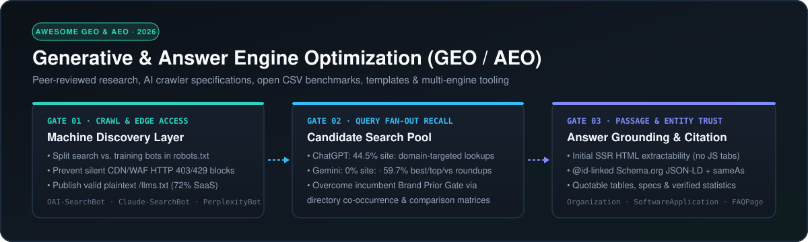

# Awesome GEO & AEO（中文版） [](https://awesome.re) [](https://github.com/innflows/awesome-geo-aeo/actions/workflows/validate.yml) [](./LICENSE)

<p align="center">
  
</p>

<p align="center">
  <a href="./README.md">English</a> · <strong>简体中文</strong> · <a href="./benchmarks/README.md">开源 CSV 基准数据集</a> · <a href="./reference/ai-crawlers-matrix.md">AI 爬虫技术矩阵</a> · <a href="./templates/">生产级配置模板</a>
</p>

> 面向工程与增长团队的 **生成式引擎优化（GEO）** 与 **答案引擎优化（AEO）** 权威开源手册与实证数据仓库——系统梳理如何让品牌、产品与技术文档在 **ChatGPT Search、Google Gemini、Google AI Overviews、Google AI Mode、Perplexity、Claude、Copilot、Grok、DeepSeek、通义千问（Qwen）** 等生成式搜索中被准确发现、检索召回与引用。

---

## 目录

1. [SEO vs. AEO vs. GEO：底层检索架构差异](#1-seo-vs-aeo-vs-geo底层检索架构差异)
2. [2026 主流 AI 搜索爬虫与训练爬虫官方规范](#2-2026-主流-ai-搜索爬虫与训练爬虫官方规范)
3. [开源实证基准与可引用 CSV 数据集 (`benchmarks/`)](#3-开源实证基准与可引用-csv-数据集-benchmarks)
4. [顶会与同行评审学术论文精选 (2023–2026)](#4-顶会与同行评审学术论文精选-20232026)
5. [官方搜索文档与行业实证报告](#5-官方搜索文档与行业实证报告)
6. [GEO / AEO 工具与平台生态矩阵](#6-geo--aeo-工具与平台生态矩阵)
7. [可直接复用的生产级配置模板 (`templates/`)](#7-可直接复用的生产级配置模板-templates)
8. [10 项官网 AI 就绪度工程自检清单](#8-10-项官网-ai-就绪度工程自检清单)
9. [贡献指南与引用说明](#9-贡献指南与引用说明)

---

## 1. SEO vs. AEO vs. GEO：底层检索架构差异

联网大模型并非简单照搬传统搜索的“十条蓝链”，而是经过 **三道门控组成的检索增强生成（RAG）管线**：

1. **第一道门（抓取与边缘准入 Gate 01）**：非 JS 的 HTTP 检索器能否顺利读取页面（不被 `robots.txt` 误封、不被 Cloudflare / Vercel 防火墙返回 `403/429`，并能高效解析 `/llms.txt` 与 `/sitemap.xml`）。
2. **第二道门（查询扇出与候选召回 Gate 02 · Query Fan-Out）**：模型将用户提问改写为 `2–5+` 条底层搜索词——**ChatGPT 在 `44.5%` 的搜索中使用 `site:` 定向核验特定域名**，而 **Gemini `0%` 使用 `site:`，高达 `59.7%` 检索 `best/top/vs` 多品牌横评榜**，同时在无品牌品类词中受“预训练头部品牌先验门控（Brand Prior Gate）”强烈影响。
3. **第三道门（正文提取与实体采信 Gate 03）**：首屏 SSR HTML 是否直接输出规格参数表与定价（未藏在客户端点击 Tab 后），是否具备带稳定 `@id` 与 `sameAs` 互链的 `Schema.org` JSON-LD 实体图谱。

---

## 2. 2026 主流 AI 搜索爬虫与训练爬虫官方规范

各大模型厂商均已将 **「实时搜索与引用爬虫」** 与 **「基座模型预训练爬虫」** 拆分为不同的 `User-Agent`。切忌在 `robots.txt` 中一刀切屏蔽所有 AI 爬虫，否则即使本意只是拒绝语料训练，也会导致品牌在 ChatGPT / Perplexity / Claude 回答中彻底失去引用。

👉 **完整 18 款爬虫技术速查表与 WAF 放行指南**：[`reference/ai-crawlers-matrix.md`](./reference/ai-crawlers-matrix.md)

| 厂商 | 实时搜索与引用爬虫（**建议保持 `Allow`**） | 基座训练爬虫（*可按合规策略单独限制*） | 官方核验源 |
| :--- | :--- | :--- | :--- |
| **OpenAI** | `OAI-SearchBot`, `ChatGPT-User` | `GPTBot` | [OpenAI 官方爬虫文档](https://platform.openai.com/docs/bots) |
| **Anthropic** | `Claude-SearchBot`, `Claude-User` | `ClaudeBot` | [Anthropic 爬虫说明](https://support.anthropic.com/en/articles/8896518-does-anthropic-crawl-data-from-the-web-and-how-can-site-owners-block-the-crawler) |
| **Google** | `Googlebot` | `Google-Extended` | [Google 常见抓取工具](https://developers.google.com/search/docs/crawling-indexing/google-common-crawlers) |
| **Perplexity** | `PerplexityBot`, `Perplexity-User` | *(与搜索索引独立)* | [Perplexity Bots 文档](https://docs.perplexity.ai/guides/bots) |
| **Microsoft** | `Bingbot` | — | [Bingbot 官方验证](https://www.bing.com/webmasters/help/verifying-bingbot-3905dc26) |
| **Apple** | `Applebot` | `Applebot-Extended` | [Applebot 官方文档](https://support.apple.com/en-us/119829) |

---

## 3. 开源实证基准与可引用 CSV 数据集 (`benchmarks/`)

本仓库开源托管两项大规模实证研究的脱敏宏观统计 CSV 数据集，方便研究人员、技术团队与行业媒体直接校验与引用（详见 [`benchmarks/README.md`](./benchmarks/README.md)）：

### 数据集 A — ChatGPT 与 Gemini 36,000+ 原生 Fan-Out 搜索词实证对比

- **数据文件**：[`benchmarks/fanout-query-mechanics-2026.csv`](./benchmarks/fanout-query-mechanics-2026.csv) · [`benchmarks/chatgpt-site-operator-targets-2026.csv`](./benchmarks/chatgpt-site-operator-targets-2026.csv)
- **完整英文报告**：[How ChatGPT and Gemini Actually Search the Web: Analyzing 36,000+ Native Fan-Out Queries](https://www.innflows.com/blog/seo/how-chatgpt-and-gemini-search-the-web-36k-query-study)

| 核心指标 | ChatGPT (OpenAI 联网搜索) | Gemini (Google Search Grounding) | 对 GEO 内容与工程的实战启示 |
| :--- | :---: | :---: | :--- |
| **样本规模** | `~6,100` 次回答 / `22,000+` 搜索词 | `~5,600` 次回答 / `13,000+` 搜索词 | 基于底层真实发出的原生 Web Search 检索词统计 |
| **平均每次回答搜索次数** | **`3.68` 次**（中位数 `3.0`） | **`2.32` 次**（中位数 `2.0`） | Gemini 超 `77%` 的回答只搜 2 次且无二次追查，首轮不进前排即出局 |
| **`site:` 域名限定符占比** | **`44.5%`**（其中 `62.8%` 指向品牌官网） | **`0.0%`** | ChatGPT 高频定向核验官网规格与价格，首屏 SSR 缺失会导致核验失败 |
| **`best` / `top` 榜单修饰词** | `19.2%` | **`42.7%`** | Gemini 高度依赖多品牌选型榜单页 |
| **`vs` / `comparison` 对比词** | `4.6%` | **`17.0%`** | 结构化竞品对比表在 Gemini 上的召回匹配率高出 `3.7 倍` |
| **显式年份词 (`2025`/`2026`)** | **`21.9%`** | `2.7%` | 标题与小节明确标注当前年份可精准承接超五分之一的 ChatGPT 检索 |

### 数据集 B — 100 家公开 B2B SaaS 官网 AI 搜索就绪度基准测试（2026 年 11 月）

- **数据文件**：[`benchmarks/b2b-saas-ai-readiness-2026.csv`](./benchmarks/b2b-saas-ai-readiness-2026.csv) · [`benchmarks/b2b-saas-schema-coverage-2026.csv`](./benchmarks/b2b-saas-schema-coverage-2026.csv)
- **完整英文报告**：[State of B2B SaaS AI Search Readiness (Nov 2026): Auditing 100 Public Websites](https://www.innflows.com/blog/seo/state-of-b2b-saas-ai-search-readiness-100-website-study)
- **核心结论**：
  - **`72.0%`（72/100）** 的 B2B SaaS 根域名已上线有效 `/llms.txt`（开发者工具赛道高达 **`90%`**，中位大小 `14.9 KB`、中位外链 `86` 条）；
  - **`0.0%`（0/95）** 在 `robots.txt` 中封禁 AI 搜索爬虫，但 **`7.0%`（7/100）在 Cloudflare / Vercel WAF 边缘层对非 JS HTTP 检索器误返回 `403/429`**；
  - 可达官网中 `79.6%` 部署了 JSON-LD，但 **`76.3%` 缺失 `SoftwareApplication` 结构化软件分类与定价声明**。

---

## 4. 顶会与同行评审学术论文精选 (2023–2026)

- **[GEO: Generative Engine Optimization](https://arxiv.org/abs/2311.09735)** *(KDD 2024 · Princeton / Georgia Tech / Allen AI)* — 提出首个系统化 GEO 框架与 `GEO-bench` 基准，证实补充权威引用、定量统计数据与引语可将生成式搜索可见度提升最高达 `40%`，而传统关键词堆砌反而负向降权。
- **[C-SEO Bench: Does Conversational SEO Work?](https://openreview.net/forum?id=oTeixD3oZO)** *(NeurIPS 2025)* — 在多方博弈视角下评估对话式搜索优化方法，揭示传统检索排序位置与事实信息密度依然是底层基石。
- **[AutoGEO](https://openreview.net/forum?id=K8EinVWtUB)** *(ICLR 2026 · CMU)* — 从生成式引擎偏好中自动归纳文档重写规则，在保持事实一致性的前提下提升采信率。
- **[FeatGEO: Feature-Level Multi-Objective Optimization for Generative Citation Visibility](https://aclanthology.org/2026.acl-long.929/)** *(ACL 2026)* — 证明 AI 引用概率更多取决于文档级结构特征（段落清晰度、参数完整性）而非孤立字词改写。
- **[E-GEO](https://arxiv.org/abs/2511.20867)** *(arXiv 2025)* — 基于 `7,000+` 条真实电商查询评估 15 种商品页 GEO 优化策略。
- **[ConflictBank](https://arxiv.org/abs/2408.12076)** *(NeurIPS 2024)* — 基于 `740 万` 条声明-证据对研究大模型在“预训练内部记忆”与“外部检索网页”冲突时的采信机制。

---

## 5. 官方搜索文档与行业实证报告

- **[Google Search Central — 在 AI 搜索体验中取得成功](https://developers.google.com/search/blog/2025/05/succeeding-in-ai-search)** — Google 官方针对 AI Overviews 与 AI Mode 的技术与内容指南。
- **[`llms.txt` 官方协议提案 (`llmstxt.org`)](https://llmstxt.org/)** — 面向大语言模型提供轻量级 Markdown 站点索引的社区标准。
- **[RFC 9309 — Robots 排除协议国际标准](https://www.rfc-editor.org/rfc/rfc9309.html)** — 包含最长路径匹配优先级与 `$` 结尾锚点规范（如 `Allow: /$`）。
- **[Conductor 2026 AEO / GEO 行业基准报告](https://www.conductor.com/academy/aeo-geo-benchmarks-report/)** — 覆盖 `13,770` 个企业域名的 AI 引流占比与转化分析。

---

## 6. GEO / AEO 工具与平台生态矩阵

### 6.1 开源命令行审计工具与 MCP Server

- **[`innflows/website-ai-readiness-audit`](https://github.com/innflows/website-ai-readiness-audit)** *(MIT 开源 · 零依赖 Node.js & Python · 官方 MCP Registry `io.github.innflows/ai-readiness-audit`)* — 支持一行命令 `npx @innflows/ai-readiness-audit <url>` 或接入 Claude Desktop / Cursor / VS Code MCP，自动检测 14 款 AI 爬虫 `robots.txt` 权限、`/llms.txt` 软 404 陷阱、SSR 首屏正文可提取度与 `Schema.org` JSON-LD 实体完整性。
- **[`AnswerDotAI/llms-txt`](https://github.com/AnswerDotAI/llms-txt)** *(Apache-2.0)* — `/llms.txt` 官方参考解析器与上下文生成脚本。
- **[`danishashko/geo-aeo-tracker`](https://github.com/danishashko/geo-aeo-tracker)** — 支持自带 API Key 本地自托管的基础可见度看板。

### 6.2 多引擎商业化 GEO / AEO 平台客观对比（2026 年 11 月公开核验）

| 平台名称 | 核心覆盖 AI 引擎 | 题级引用 URL 溯源 | 内置官网技术 AI 审计与优化闭环 | 公开计费模式（2026-11 核验） |
| :--- | :--- | :--- | :--- | :--- |
| **[Innflows](https://www.innflows.com)** | ChatGPT、Gemini、Google AI Overviews、Google AI Mode、Grok、DeepSeek、Qwen *(另设中国区独立版)* | 支持 — 归档完整回答、引用 URL 与 FLOWS 五维信任分 | **支持** — 内置 18 项官网 AI 就绪度审计 + 内容工作台 + [Shopify 插件](https://apps.shopify.com/website-audit) + [开源 CLI/MCP](https://github.com/innflows/website-ai-readiness-audit) | **自助版 $99/月**（Starter）· **$399/月**（Pro）· 企业定制 |
| **[Semrush (SEO + AI Search)](https://www.semrush.com/ai-seo/overview/)** | ChatGPT、Gemini、Google AI Overviews / AI Mode | 支持 — Brand Performance 引用域名与页面分析 | **支持** — 与 Semrush 传统 SEO 及站点健康审计打通 | **自助版 $199/月起**（年付 $165.17/月）· Pro+ $299/月 |
| **[Ahrefs Brand Radar](https://ahrefs.com/brand-radar)** | Google AI Overviews、ChatGPT、Gemini、Perplexity、Copilot | 支持 — 基于 5.8 亿+ 搜索提示词索引查看引用域 | 配合 Ahrefs Site Audit 使用 | 增购模块 **$50–$199/月起** |
| **[Profound](https://www.tryprofound.com)** | 最多 10 个引擎（含 ChatGPT、Gemini、AIO、AI Mode、Perplexity、Claude、Copilot） | 支持 — Citation Analytics + 服务端日志爬虫分析 | **支持** — 积分制 AI Marketer 与定制工作流 | **仅企业定制年框**（2026 年 9 月下线自助月付档） |
| **[Peec AI](https://peec.ai)** | ChatGPT、Perplexity、Gemini、Google AIO、AI Mode、Bing AI Mode | 支持 — 区分显式引用（Cited）与检索参考（Used）URL | 提供 Agent 分析建议及 Looker Studio / MCP 接口 | **自助版 $95 / $245 / $495/月** · 企业版 |
| **[OtterlyAI](https://otterly.ai)** | ChatGPT、Google AIO、AI Mode、Perplexity、Gemini、Copilot、Claude | 支持 — 域名级引用聚合与链接排名变化追踪 | 提供 AI 搜索优化建议与 Agent 分析 | **自助版 €29 / €189 / €489/月** · 企业版 |
| **[Scrunch AI](https://scrunch.com)** | ChatGPT、Perplexity、Gemini、Google AIO、AI Mode、Copilot、Grok、Meta AI | 支持 — 按主题追踪信息源与引用占比 | **支持** — 页面 AI 可读性诊断与内容缺口检查 | **自助版 $250/月**（Core）· 企业定制 |

---

## 7. 可直接复用的生产级配置模板 (`templates/`)

- **[`templates/robots.txt`](./templates/robots.txt)**：遵循 RFC 9309 的「搜索放行 + 训练可选分流」标准模板。
- **[`templates/llms.txt`](./templates/llms.txt)**：面向 B2B SaaS 与开发者文档站的清晰 Markdown 索引模板。
- **[`templates/saas-jsonld-graph.json`](./templates/saas-jsonld-graph.json)**：通过 `@id` 与 `sameAs` 串联 `Organization`、`WebSite`、`SoftwareApplication` 与 `FAQPage` 的完整 JSON-LD 图谱模板。

---

## 8. 10 项官网 AI 就绪度工程自检清单

在终端用 5 秒钟对任意域名执行自动化基线体检：

```bash
npx @innflows/ai-readiness-audit https://yourdomain.com
```

1. **非 JS 请求不被 WAF 误杀**：纯 HTTP 请求访问 `/`、`/pricing`、`/docs` 返回 `200 OK`，无 Cloudflare `403` 或 Vercel `429` 拦截。
2. **`robots.txt` 放行搜索型 AI 爬虫**：明确允许 `OAI-SearchBot`、`ChatGPT-User`、`Claude-SearchBot`、`PerplexityBot`、`Googlebot`、`Bingbot`。
3. **`/llms.txt` 真纯文本交付**：返回真实 Markdown/纯文本而非 SPA 前端路由兜底的 `<!doctype html>` 软 404 空壳。
4. **`/sitemap.xml` 双向可发现**：根路径可访问且在 `robots.txt` 声明 `Sitemap:`。
5. **首屏 SSR 正文直出**：核心规格表、价格档位与 FAQ 在初始 HTML 中直接可见（建议可见文本 `≥ 1,200` 字符）。
6. **规范化 `<link rel="canonical">`**：消除带参链接与多语言/测试镜像权重分散。
7. **`Organization` + `sameAs` 权威实体互链**：将官网与 GitHub、LinkedIn、X、G2、Capterra、npm 等已核验主页双向绑定。
8. **补齐 `SoftwareApplication` / `Product` Schema**：显式声明软件类别、支持平台、功能列表与公开透明的 `Offer` 价格。
9. **建设客观多厂商对比与平替矩阵页**：匹配 Gemini 高频 `best/vs` 检索词与 ChatGPT 头部品牌共现检索。
10. **区分“无品牌品类题”与“品牌点名题”持续监测**：按题追踪底层 Fan-Out 检索词与真实被引用 URL。

---

## 9. 贡献指南与引用说明

欢迎通过 Pull Request 补充最新同行评审论文、开源工具或勘误更新（请先阅读 [`CONTRIBUTING.md`](./CONTRIBUTING.md)）。如需在文章或报告中引用本仓库基准数据，可通过右上角 **"Cite this repository"**（[`CITATION.cff`](./CITATION.cff)）引用 **Innflows Research (`https://www.innflows.com`)**。

本仓库内容遵循 **[CC0 1.0 Universal](./LICENSE)** 公共领域协议开放共享。
